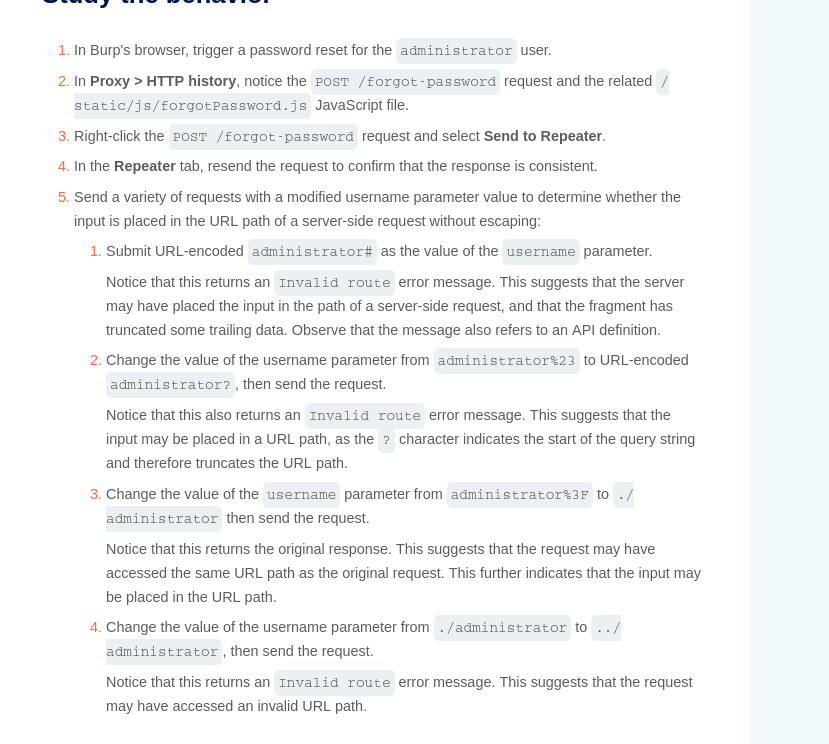

# Lab 5 – Exploiting Server-Side Parameter Pollution in a RESTful URL

**Platform:** PortSwigger Web Security Academy (API testing)
**Category:** Server-side parameter pollution (REST path)
**Goal:** Log in as `administrator` and delete the user `carlos`.

## Background
When an application puts user input into the **path** of a request to an internal API without encoding it, an attacker can inject path-traversal sequences and extra path segments to reach other internal endpoints. This is server-side parameter pollution in a RESTful URL.

## Approach

### 1. Study the behavior
1. Triggered a password reset for `administrator` in Burp's browser.
2. In **Proxy > HTTP history** found `POST /forgot-password` and its script `/static/js/forgotPassword.js`.
3. Sent the request to **Repeater** and resent it to confirm the response was consistent.



### 2. Test whether `username` ends up in a server-side URL path
| Payload for `username` | Result | What it tells me |
|---|---|---|
| `administrator#` (URL-encoded `%23`) | `Invalid route` | Fragment truncated something after the input, and the error mentions an API definition |
| `administrator?` (`%3F`) | `Invalid route` | `?` starts a query string, so the input is probably in a URL path |
| `./administrator` | Original response | Same URL path was reached, so the input is in the path |
| `../administrator` | `Invalid route` | Traversed to an invalid path |

Conclusion: the `username` value is placed in the path of an internal API request without proper encoding.

### 3. Find the API definition
1. `../%23` → `Invalid route`.
2. Added more `../` until `../../../../%23` → `Not found`, meaning I had moved outside the API root.
3. At that level, tried common API definition filenames:

   ```
   username=../../../../openapi.json%23
   ```

   The error message revealed an internal endpoint:

   ```
   /api/internal/v1/users/{username}/field/{field}
   ```

   So the path contains a second parameter, `field`.


### 4. Exploit
1. Used the structure of the endpoint with an invalid field:

   ```
   username=administrator/field/foo%23
   ```
   Error: the API only supports the `email` field.

2. Used a valid field:

   ```
   username=administrator/field/email%23
   ```
   Original response returned, so the injected `field` is accepted and `email` is valid.

3. Read `/static/js/forgotPassword.js` and found the reset flow uses a token:

   ```
   /forgot-password?passwordResetToken=${resetToken}
   ```

4. Tried to read the token directly:

   ```
   username=administrator/field/passwordResetToken%23
   ```
   Error: `passwordResetToken` isn't supported by this API version (v1).

5. Used traversal to call a different API version:

   ```
   username=../../v1/users/administrator/field/passwordResetToken%23
   ```
   This returned the **password reset token** for `administrator`.

6. Opened the reset page in Burp's browser with the token:

   ```
   /forgot-password?passwordResetToken=<token>
   ```
7. Set a new password, logged in as `administrator`.
8. In the **Admin panel**, deleted `carlos`, which solved the lab.


## Root cause
The user-supplied `username` is concatenated into an internal REST URL without being URL-encoded or validated, which allows path traversal (`../`), fragment truncation (`%23`) and injection of extra path segments (`/field/...`).

## Remediation
- URL-encode user input before placing it in a server-side request path.
- Validate `username` against a strict allow-list (e.g. alphanumerics only).
- Don't expose internal API definitions or verbose "Invalid route" errors.
- Don't return sensitive values like reset tokens from internal endpoints a user flow can reach.

## Takeaways
- Different error messages (`Invalid route` vs `Not found` vs original response) act as an oracle for mapping the server-side path.
- `%23` (`#`) and `%3F` (`?`) are useful to truncate trailing parts of the internal URL.
- Traversing to another API version can expose fields the current version blocks.